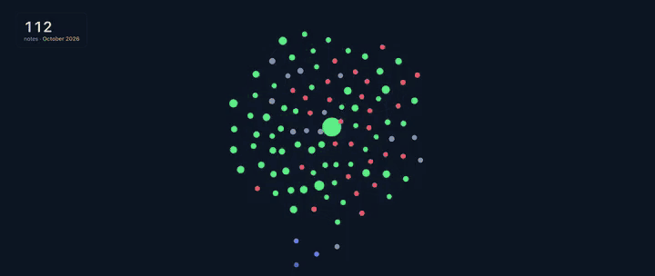

# engram

Claude Code forgets your projects between sessions. engram gives it a memory: an Obsidian vault of short, linked notes about why things are the way they are, when they changed and where they live in the code. An engram is the trace a memory leaves in the brain.

<p align="center"></p>

## What you get

- Answers about your own history. Ask "why did we move sessions to Redis?" or "when did the export change?" and Claude finds the note, reads the reason and goes straight to the right file.
- Sessions that start where you left off. Every project gets a status note: what is in progress, what comes next, open questions, what was tried and did not work.
- More from cheaper models. With the vault, Haiku answered a set of 20 questions as fully as Opus, at about a fortieth of the cost.
- A graph that shows Claude at work. The optional live graph (`/engram:setup live`) lights up the notes Claude reads and edits in Obsidian, while it works.
- Control over what is read. You choose per project what Claude may read, nothing leaves your machine through engram, and your own notes are never overwritten: changes to them come as proposals you accept or drop.
- Notes you can trust. Every note cites its source and date, and `/engram:check` flags missing sources, broken links and notes whose code has changed since.

## Get started

You need Claude Code and git. Obsidian is optional.

1. Install the plugin:
   ```sh
   claude plugin marketplace add muazfurkan/engram
   claude plugin install engram@engram
   ```
2. Open Claude Code in the folder that holds your projects (for example `~/code`) and run `/engram:setup`. It asks everything in one message; reply `ok` to take its suggestions.
3. Run `/engram:scan`. It shows a plan and writes nothing before your OK.

From then on Claude looks in the vault before it searches the code, and when a task is done it writes down what changed (`/engram:note`, or just ask). Installing from inside Claude Code, updating, removing, Windows and common problems: [docs/install.md](docs/install.md).

## How it works

engram is a Claude Code plugin with four skills. The vault sits inside your projects folder, in a local git repository with no remote.

```
projects/
├── CLAUDE.md     + a short routing block
├── api/          your projects, untouched
├── web/
└── brain/        the vault: Projects, Decisions, Releases, Tech, Concepts, Daily, Log
```

| Skill | What it does |
|---|---|
| `/engram:setup` | Sets up the vault, the privacy level per project and the routing block. |
| `/engram:scan` | Reads your projects and proposes notes; later rescans only what changed. |
| `/engram:note` | After a task, writes what changed and updates the status note. |
| `/engram:check` | Health check, with fixes on request. |

Each note has a one-line description, a date, its source and the code paths it is about. The routing block tells Claude to search those descriptions first, open at most three notes and go to the code they name.

## The numbers

I measured it on my own workspace (several projects, about 370 notes) with 60 questions, asked with and without the vault on Claude Sonnet 5.5. Cost per question was the same, and per fully correct answer the vault came out about 10 percent cheaper. It helped most where the code is silent: history (15 vs 11 out of 16 fully correct), decisions (12 vs 10 out of 16) and questions across projects (12 vs 9 out of 14). It did worse on change plans, where Claude trusted the notes and missed files, so ask it to check the code for those. One workspace, so read this as a direction.

## Privacy

Each project folder is `full` (docs, code, git history), `structure` (file names only) or `none` (skipped), and `.env` files, keys and credentials are never read. Setup writes these as read-deny rules in `.claude/settings.json`, so they hold in every session. What a skill reads does go to the model, so check your employer's policy before you use engram on work code. Keep the vault in a plain local folder (iCloud Drive on Windows can corrupt files) and pause file sync during a scan.

On Windows, install Git for Windows first: engram's helpers run in its Git Bash. engram has not been tried on a real Windows machine yet, so please open an issue if something breaks.

## Develop

```sh
sh tests/run.sh            # shell helpers and the live graph hook
claude plugin validate .
claude --plugin-dir .      # try it without installing
```

The note format and every rule are in [reference/conventions.md](reference/conventions.md); `examples/` holds two made-up projects and the vault built from them.

## License

[MIT](LICENSE)
